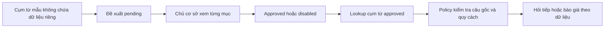

# Bộ nhớ cụm từ do chủ cơ sở duyệt

Bộ nhớ này là một danh sách cách nói đã được người quản lý xem và duyệt. Nó giúp Mầm hiểu một cụm từ cụ thể thành ý định hoặc nhóm sản phẩm, không huấn luyện model và không tự học từ cuộc trò chuyện của khách. Không lưu hay đưa dữ liệu khách vào danh sách.

Một mục chỉ ánh xạ cụm từ sang `intent` và `categoryId`. Không chứa giá, tổng tiền, số lượng, vật liệu, gia công, nguồn giá hoặc câu trả lời tự do. Giá và các thông số vẫn do phiên local, dữ liệu đã xác minh và policy hiện tại quyết định.

## Từ đề xuất tới sử dụng



Người hỗ trợ hoặc chủ cơ sở có thể tạo đề xuất, nhưng đề xuất không tự được dùng. Chủ cơ sở kiểm tra cụm từ, ý định và nhóm sản phẩm, rồi mới duyệt mục đó. Mục pending hoặc disabled không tham gia lookup. Có thể vô hiệu hóa mục đã duyệt để ngừng dùng nó.

Chỉ dùng câu mẫu tự soạn hoặc đã loại mọi thông tin riêng. Không sao chép chat thật, tên/số điện thoại/địa chỉ, file đặt hàng hoặc khóa vào JSON hay lệnh CLI. Danh sách có thể được đưa vào assets công khai; đừng coi file này là nơi lưu thông tin nội bộ.

## Hợp đồng local

`widget/approved-language.js` cung cấp `ThanhAnApprovedLanguage.validateData(data)` và `create(data)`. Chuẩn hóa chữ hoa/thường, dấu tiếng Việt, dấu câu và khoảng trắng; sau đó so khớp **toàn bộ cụm từ**, không tìm một đoạn nhỏ trong câu. Instance trả kết quả giới hạn:

```json
{"intent":"product","categoryId":"catalogue"}
```

Không khớp mục approved thì trả null. `getCounts()` chỉ đọc số mục theo trạng thái. Không có fuzzy match, model call hoặc ghi dữ liệu trong lookup.

`ThanhAnFAQ.createSession(data).answer(input, {approvedCategoryId})` nhận category đã duyệt như một gợi ý giới hạn. Options chỉ được có một khóa category hợp lệ. Nhận diện local thông thường được ưu tiên; category chỉ giúp nhận diện một sản phẩm mới khi câu ban đầu chưa xác định được sản phẩm. Không ghi đè sản phẩm/thông số đang nhận diện, nội dung ngoài phạm vi hoặc input không an toàn. Policy vẫn phân tích và kiểm tra **câu gốc**, không nhận số lượng/quy cách/giá từ bộ nhớ.

Ví dụ, sau khi xác định catalogue A4/300 cuốn, câu trả lời tiếp “16 trang” giữ A4/300 và chỉ bổ sung số trang. Luồng này đã có và được giữ nguyên. Khách phải chọn vật liệu thực sự có trong nhóm phù hợp rồi mới báo giá; không mặc định giấy sau “16 trang”. Thông số xung đột phải được làm rõ; nhiều sản phẩm trong một câu không được khôi phục báo giá cũ; quy cách không hỗ trợ chuyển tư vấn.

## Trạng thái và phê duyệt

File `widget/approved-language.json` dùng schema version 1 và danh sách entries. Mỗi entry có id, phrase, intent, categoryId, status, author và review. Author là owner hoặc assistant; status là pending, approved hoặc disabled. Pending có review null. Review đã duyệt/vô hiệu hóa có đúng bốn trường `decision`, `byRole`, `at`, `mappingKey`: quyết định approved/disabled, vai trò owner, thời điểm UTC ISO và dấu đối chiếu ánh xạ.

`mappingKey(entry)` tạo JSON chuẩn của `[normalizedPhrase,intent,categoryId]`. Validator yêu cầu review chứa đúng mappingKey hiện tại. Thay đổi làm khác cụm từ đã chuẩn hóa, intent hoặc category không được hưởng phê duyệt cũ; phải review lại. Những khác biệt hoa/thường, dấu, dấu câu hoặc khoảng trắng cùng chuẩn hóa thành một cụm thì vẫn là cùng ánh xạ. Đây là kiểm tra toàn vẹn dữ liệu, không chứng minh người đã chạy lệnh là chủ cơ sở. Duyệt không đổi author của đề xuất; review ghi vai trò owner riêng.

Giới hạn: tối đa 250 entries, 120 ký tự mỗi phrase lưu, 20 từ và 500 ký tự đầu vào lookup; câu lookup vẫn phải qua cùng bộ lọc. CLI chỉ đọc/ghi file JSON cục bộ tối đa 128 KiB, nên không bảo đảm 250 mục dài nhất cùng vừa giới hạn file. Số/chữ số, ký hiệu tiền, đơn vị/quy cách, mẫu thông tin riêng và prompt đổi quy tắc bị chặn khi đăng ký/lookup. Đây là bộ lọc định dạng/từ khóa thận trọng, không bảo đảm phát hiện mọi thông tin riêng và không thay việc người quản lý kiểm tra nội dung.

Danh sách khởi tạo hiện có **3 pending, 0 approved, 0 disabled**, đều do assistant đề xuất. Các mục pending không được dùng để trả lời khách.

CLI `tools/review-language.mjs` là công cụ quản trị trên bản sao mã nguồn, không phải API cho khách. Việc khai vai trò owner và xác nhận đã review là thao tác tin cậy của người có quyền ghi workspace/OS, không phải đăng nhập hay xác thực danh tính của chủ cơ sở. Khách truy cập widget không có quyền duyệt hoặc sửa file này.

## Lệnh review

Chạy từ thư mục gốc của dự án. Đọc danh sách và ý nghĩa từng ánh xạ trước:

```text
node tools/review-language.mjs --help
node tools/review-language.mjs list
```

Ví dụ tạo câu mẫu mới, không chứa số lượng/quy cách/dữ liệu khách:

```text
node tools/review-language.mjs propose --phrase "quyển giới thiệu sản phẩm" --intent product --category catalogue --author assistant
```

Lệnh trả id và trạng thái pending. `--author owner` cũng tạo pending, không tự duyệt. Với intent khác product, bỏ `--category`; category được lưu null. Intent/category phải thuộc allowlist của module. Cụm từ trùng hoặc xung đột sau chuẩn hóa bị từ chối.

Sau khi chủ cơ sở đã đọc và quyết định dùng mục khởi tạo `candidate-catalogue-wardrobe`, có thể duyệt riêng mục đó:

```text
node tools/review-language.mjs approve --id candidate-catalogue-wardrobe --reviewer owner --ack-owner-review
node tools/review-language.mjs list
```

Với đề xuất khác, thay id bằng id đã xem trong kết quả list. Không chạy lệnh duyệt thay cho bước đọc ánh xạ. Muốn ngừng dùng một mục:

```text
node tools/review-language.mjs disable --id candidate-catalogue-wardrobe --reviewer owner --ack-owner-review
```

CLI tự ghi UTC/mappingKey và kiểm tra JSON; không cần tự sửa review. Thay phrase/intent/category thì tạo đề xuất mới, vô hiệu hóa mục cũ nếu cần và review lại. `--ack-owner-review` xác nhận thao tác đã đọc, không xác thực danh tính.

Mọi lệnh có thể dùng `--file PATH` để quản lý một bản sao JSON đã có. Ví dụ trên PowerShell:

```powershell
Copy-Item -LiteralPath '.\widget\approved-language.json' -Destination '.\language-review-copy.json'
node tools/review-language.mjs list --file .\language-review-copy.json
```

Muốn thử propose/approve/disable trên bản sao, thêm cùng `--file .\language-review-copy.json` vào từng lệnh. CLI không tạo file dữ liệu mới từ một đường dẫn thiếu. Nó khóa thao tác ghi, dùng file tạm/đổi tên và từ chối nếu file đổi giữa lúc đọc và ghi; lỗi validation không làm tăng số mục hay tự phê duyệt. Không có thao tác hàng loạt tự approve.

Đã đối chiếu `--help` và chạy list chỉ đọc: ba mục khởi tạo đều pending, không mục approved. Bộ test riêng module/CLI đạt **20/20**, kiểm tra syntax cũng đạt; thao tác CLI bị từ chối giữ nguyên bytes của file dữ liệu. Source tích hợp đã đóng băng đạt **693/693 Node**, **75/75 browser mock** ở cả 1280×720 và 320×568, cùng **107/107 native/widget** ở 1280×720, không lỗi. Report: `evidence/oct13-language-memory-tests.txt`, `evidence/language-browser-desktop.json`, `evidence/language-browser-mobile-320.json`, `evidence/language-browser-native-desktop.json`. Mock không gọi Google. Deployment tính năng mới vẫn cần xác nhận riêng, chưa coi các mục pending là đã được chủ cơ sở duyệt.

```text
node --test tests/approved-language.test.mjs
```

Chạy kiểm thử tương ứng và build lại trước khi đưa danh sách đã duyệt vào bản phát hành; không dùng dữ liệu khách thật để kiểm thử.
