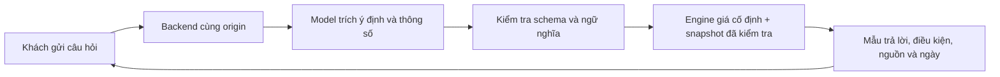

# Adapter LLM tùy chọn cho Mầm

Đây là thiết kế cho một bước nâng cấp sau này, chưa được triển khai hoặc kết nối. Bản local hiện tại xử lý hội thoại bằng quy tắc trong trình duyệt. Không có backend LLM, API key, lời gọi model hoặc việc gửi nội dung khách hàng ra ngoài. `widget/intent-schema.json` là hợp đồng tham khảo, không được widget hay plugin tự nạp.

## Vai trò giới hạn của model

Model chỉ nhận diện ý định và trích xuất thông tin khách đã nêu: sản phẩm, số lượng/đơn vị, khổ, số trang, giấy và gia công. Model trả JSON theo schema, không trả câu trả lời tự do. Thông tin thiếu hoặc chưa được khách xác nhận phải là `null`; không tự điền quy cách mặc định. Câu trả lời ngắn như “1.000 cuốn” chỉ được gắn vào sản phẩm/ngữ cảnh đã được xác nhận trong phiên.

Model không được trả giá, đơn giá, tổng tiền, phần trăm giảm, hạn giao, thuế, nguồn URL hoặc liên hệ. Schema không có những trường đó và dùng `additionalProperties: false`. Yêu cầu giảm giá/hạn giao được phân loại để engine chuyển tư vấn viên. Nội dung ngoài phạm vi hoặc không hiểu được dùng `out_of_scope`, `unknown` hoặc `clarify`; câu trả lời do mẫu cố định tạo ra.



Luồng này chỉ là đề xuất. Trong bản local, câu hỏi đi thẳng tới engine trong trình duyệt và không qua backend/model.

## Engine vẫn là nơi duy nhất quyết định giá

Backend tương lai cần dùng cùng dữ liệu và chính sách đã kiểm thử của `widget/policy.js`, không thay bằng việc hỏi model để báo giá. Không được ánh xạ tùy tiện JSON thành câu lệnh `lookupQuery` nhằm vượt các bước hỏi làm rõ.

- Kiểm tra JSON trên server: đúng schema/version, không có trường lạ, `productId` thuộc snapshot đang dùng. Các trường chuỗi chỉ là dữ liệu chưa tin cậy; không hiển thị nguyên văn hoặc thực thi chúng.
- Kiểm tra ngữ nghĩa với câu hỏi và ngữ cảnh đã xác nhận: số lượng/đơn vị phải rõ, các thông số không được mâu thuẫn, gia công lạ cần hỏi lại. JSON đúng schema chưa đủ điều kiện đưa giá.
- Chỉ engine chọn một dòng công bố khi thông số khớp điều kiện. Thiếu thông số, nhiều dòng phù hợp, số lượng ngoài bảng, nguồn mâu thuẫn hoặc snapshot quá hạn thì hỏi lại/chuyển tư vấn viên. Không nội suy hay tự nhân đơn giá.
- Chỉ hiện tổng đã có tại nguồn nếu khách yêu cầu tổng công bố và chọn đúng dòng. Giá, điều kiện, ngày và URL đều lấy từ snapshot đã kiểm tra, không lấy từ output model.
- Timeout, output sai schema hoặc lỗi model quay về câu hỏi làm rõ/engine local. Không dùng một câu trả lời model chưa kiểm tra làm fallback.

Ví dụ hợp đồng cho câu “catalogue A4 12 trang 1.000 cuốn”:

```json
{
  "schemaVersion": 1,
  "intent": "price_lookup",
  "productId": "catalogue",
  "quantity": 1000,
  "quantityUnit": "cuốn",
  "size": "A4",
  "pages": 12,
  "material": null,
  "finishing": null
}
```

Ví dụ này chỉ trích thông tin; engine vẫn quyết định cần hỏi gì và có thể hiển thị dòng nào. Danh sách `productId` phải được cập nhật cùng snapshot khi thêm hoặc đổi sản phẩm.

## Các quyết định cần có trước khi kết nối

1. **Backend và vận hành:** chọn nơi chạy, đường dẫn cùng origin, giới hạn request/timeout và người bảo trì. Secret nằm ở server, không đưa vào HTML, JS, JSON công khai hay WordPress assets. Kiểm thử trên staging trước khi bật.
2. **Model và chi phí:** chọn nhà cung cấp/model sau khi thử tiếng Việt, lỗi chính tả và câu trả lời ngắn; xác định ngân sách, giới hạn dùng và xử lý khi hết ngân sách. Gói hiện tại chưa chọn nhà cung cấp, mua dịch vụ hoặc cấu hình tài khoản.
3. **Dữ liệu khách hàng:** quyết định rõ thông tin nào được phép gửi từ browser tới server rồi tới nhà cung cấp. Ưu tiên chỉ câu mới nhất và thông số đã xác nhận, tránh gửi toàn bộ lịch sử; xử lý thông tin cá nhân trước khi gọi model. Xác định lưu giữ/log, quyền truy cập, khu vực xử lý và thông báo cho khách phù hợp. Việc kết nối sẽ thay đổi luồng dữ liệu hiện tại, vì vậy cần được quyết định rõ trước khi bật.
4. **Nghiệm thu:** kiểm tra schema sai, prompt yêu cầu đổi quy tắc, thông số bị đoán, snapshot quá hạn, bảng giá mâu thuẫn, model/backend lỗi và quay về chế độ local. Những trường hợp này phải giữ nguyên quyền quyết định của engine giá.

Tài liệu này không cài backend, không bật endpoint, không sửa bảo mật website và không tạo lời gọi mạng. Chưa có quyền mua dịch vụ, thiết lập tài khoản hoặc gửi nội dung khách hàng tới model trong bước này.
