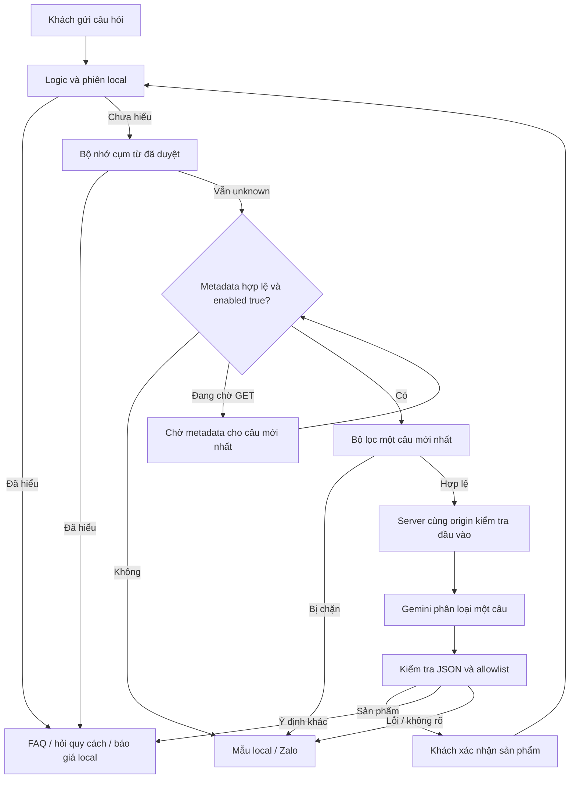

# Gemini Free: bộ phân loại ý định khi khả dụng

Mã hiện tại: `api/mam-assist.js`, `server/gemini-assistant.mjs`, `widget/gemini-client.js`. Cơ chế tắt khi thiếu cấu hình; demo Production hiện đã bật backend `gemini-3.5-flash-lite`. Widget mặc định hiểu sâu sau khi metadata hợp lệ báo khả dụng, không còn checkbox hoặc dòng chọn chế độ. Standalone và WordPress không mount endpoint. Chủ sở hữu đã chấp thuận/tự lưu khóa có sẵn dưới dạng Secret Production; người hỗ trợ không đọc khóa. AI Studio Default Gemini Project Free/quota đã kiểm tra, và hai lần phân loại thật/UI xác nhận đã thành công ngày 13/10/2026 trên commit `6907`. Deployment cuối của bản sửa dữ liệu/giao diện mới còn chờ. Test tự động vẫn dùng fetch giả lập. [Cấu hình và quota quan sát](gemini-free-setup.md).

**Bản sửa hiểu sâu mặc định được chuẩn bị từ `6aee189`.** Kết quả kiểm thử/build và trạng thái triển khai được ghi riêng trong báo cáo bàn giao; các kết quả gọi thật và nghiệm thu lịch sử bên dưới thuộc những bản trước.

## Luồng dữ liệu



Local và bộ nhớ cụm từ đã duyệt xử lý trước. Chỉ `kind:'unknown'` còn lại mới có thể gọi Gemini. Giao diện chính ẩn nhãn model/backend và không có điều khiển chọn chế độ. Bản sửa ngày 14/10/2026 bỏ nút i **Thông tin & quyền riêng tư** và toàn bộ panel thông tin, cả ở standalone/chỉ chạy local; không thêm thông báo hay link thay thế. Panel bị bỏ chỉ cung cấp thông tin, không phải checkbox đồng ý hoặc điều khiển gửi AI. Cơ chế gửi và kiểm soát AI bên dưới giữ nguyên.

Widget kiểm tra GET metadata cùng origin, không chứa chat. Chỉ metadata hợp lệ với `enabled:true` mới tự gọi `setConsent(true)`; nếu còn chờ GET, câu `unknown` mới nhất chờ kết quả này trước POST. Metadata lỗi/không khả dụng trả về local. Làm mới, đóng panel hoặc gửi câu mới hủy POST và câu đang chờ metadata, bỏ kết quả đến muộn mà không tắt mặc định hiểu sâu. GET metadata được phép hoàn tất sau các thao tác đó; `destroy()` hủy cả GET. Không gửi lại câu đã bị hủy sau khi metadata đến muộn.

Browser gửi một câu mới nhất tối đa 500 ký tự đã qua bộ lọc, không lịch sử/snapshot giá/file/dữ liệu đặt hàng. Ứng dụng không thu thập chat riêng và không lưu chat bền vững. Server gửi câu đó cùng system instruction cố định. Bộ lọc chặn nhiều mẫu email/điện thoại/địa chỉ/khóa/injection, không nhận diện được mọi thông tin riêng.

## Hợp đồng phân loại

Model chỉ trả:

```json
{"intent":"product","categoryId":"catalogue"}
```

Intent: `product`, `services`, `hours`, `address`, `contact`, `greeting`, `out_of_scope`, `unknown`. Category chỉ được có giá trị khi product, thuộc 13 nhóm: `namecard`, `catalogue`, `decal`, `flyer`, `bag`, `box`, `envelope`, `red-envelope`, `receipt`, `folder`, `tag`, `menu`, `wedding`. Ý định khác bắt buộc category null.

[intent-schema.json](../widget/intent-schema.json) mô tả hợp đồng đầy đủ; server tạo schema nhỏ tại runtime và kiểm tra quan hệ intent/category riêng. Widget không fetch schema file. Không có trường prose, số lượng, khổ, giấy, giá, tổng, giảm giá, deadline, URL hay liên hệ. Server/browser từ chối khóa lạ, category ngoài danh sách và tổ hợp sai; không hiện raw model text/lỗi upstream.

Sản phẩm gợi ý chỉ hiện nút xác nhận từ nhãn local. Khách xác nhận mới đưa câu hỏi sản phẩm cố định vào local hỏi số lượng/quy cách. Model không tự điền thông số hoặc mở bảng đầy đủ. Ý định FAQ dùng câu hỏi/mẫu local.

## Endpoint

GET `/api/mam-assist` không lộ model/project/key:

```json
{"version":1,"enabled":false,"privacyVersion":"google-free-v1"}
```

POST chỉ nhận đúng bốn trường JSON UTF-8:

```json
{"version":1,"message":"Mình cần một ấn phẩm giới thiệu sản phẩm","consent":"google-free-v1","adult":true}
```

`consent:'google-free-v1'` và `adult:true` được giữ để tương thích hợp đồng backend. Trong bản sửa này, đây là giá trị mặc định do client đặt sau metadata hợp lệ, không phải bằng chứng người dùng đã xác nhận checkbox, đồng ý riêng trong phiên hoặc được kiểm chứng tuổi.

Response hợp lệ:

```json
{"version":1,"kind":"suggestion","intent":"product","categoryId":"catalogue"}
```

Fallback:

```json
{"version":1,"kind":"fallback"}
```

Origin mặc định `https://test-mam.vercel.app`. POST cần Origin khớp chính xác; endpoint không query. Chỉ tin IP/country header Vercel edge trên Vercel. Ngoài VN, sai Origin/payload, rate limit hoặc thiếu config trả status phù hợp; client về local. Response no-store, không CORS wildcard/cookie auth.

## Google request và giới hạn

POST `https://generativelanguage.googleapis.com/v1beta/interactions`, khóa header `x-goog-api-key`, không URL. Production chọn `gemini-3.5-flash-lite`; default trong mã là `gemini-3.8-flash` nếu không đặt model. Schema JSON, `store:false`, output tối đa 512 tokens, thinking low, không thinking summary. Không history/previous interaction ID/tools/search/background/retry/tự chuyển model. REST đọc `steps → model_output → content:text` rồi validate. [Interactions](https://ai.google.dev/api/interactions-api), [structured output](https://ai.google.dev/gemini-api/docs/structured-output).

| Giới hạn | Hiện tại |
| --- | --- |
| Input | 500 ký tự, request 4.096 byte, đọc tối đa 2 giây |
| Google | Timeout 6 giây, body 16.384 byte, text JSON 2.048 byte |
| Function | maxDuration 10 trong vercel.json |
| Client | GET 5 giây, POST 7 giây, khoảng cách gọi 10 giây |
| Mỗi instance server | 6/IP/phút, 30 tổng/phút, 2 đồng thời |
| Limiter | Tối đa 1.000 IP hash, cửa sổ hiệu lực 60 giây |

Limiter best effort theo instance ấm, không chia quota giữa instance/region; restart mất bộ đếm. Không phải hard cap toàn deployment hay quota Google. IP HMAC dùng salt riêng; app không log/lưu raw IP. Hash hết hiệu lực logic sau 60 giây, dọn vật lý lần acquire tiếp theo, không cam kết timer xóa đúng giây. Không database/cookie/lưu chat của app; Vercel/Google xử lý request theo chính sách hạ tầng riêng.

## Engine quyết định giá

Gemini không có snapshot/không quyết định giá. Baseline web bất biến có 177 dòng. Bốn ma trận viết tay đã được chủ cơ sở xác nhận và runtime đã sửa thành **193 dòng**: thêm 10 catalogue (7 mốc số lượng 300, 3 dòng 36 trang nguồn tham khảo) và 6 bông tai. Có 62 dòng mang owner revision (46 sửa, 16 mới); phân loại giá hiện tại là 148 per_unit, 27 source_total, 18 reference_display. Engine vẫn giữ đúng nhóm quy cách/đơn vị/nguồn, ưu tiên Thanh Ấn khi khớp. Hỏi ngắn giữ thông số local; chỉ yêu cầu **Xem bảng giá** mới mở toàn bảng.

Runtime có 22 sản phẩm-biến thể; giá/metadata đã hoàn tất. SHA-256 dữ liệu cuối: `2521ee2d7d238574837567eec14073b25f3cf9081faa3a98c1a62e11dae62615`. SHA-256 policy hiện tại: `023d999828a83ca226655cfe6bed8d70d1dea8af63d04a84d0a045014c4962de`. Baseline lịch sử và artwork native không đổi.

Website được cập nhật bằng công việc riêng. Dataset giữ bằng chứng baseline lịch sử và provenance chủ cơ sở, không khẳng định từng giá sửa đã được công bố chính xác trên web. Đối chiếu xác nhận 21 URL sản phẩm/177 URL dòng giá gốc không đổi; tác vụ Mầm không sửa URL/slug/canonical/redirect website.

[Nguồn tham khảo bông tai](https://invinhphat.com/san-pham/in-tag-treo-khuyen-tai/) đã xác minh Couche 300gsm và offset hai mặt. Nguồn cho chọn cán màng mờ hoặc không cán, nhưng chưa nói phương án nào gồm trong giá. Cán màng vẫn cần xác nhận; `ownerRecipeIncomplete:true` tiếp tục handoff, không tự tính tổng cho quy cách chưa đầy đủ. Sáu dòng chỉ bổ sung specs/metadata và secondarySourceUrls: record giá chủ cơ sở vẫn có URL nguồn chính null, baseline lịch sử giữ nguyên, không đổi giá/VAT hoặc tạo live sync.

Chính sách chủ cơ sở `owner-floor-tier-2026-10-13`: giá mỗi đơn vị rõ ràng chọn mốc công bố lớn nhất không vượt số lượng yêu cầu; trên mốc cuối giữ cùng đơn giá. Dưới mốc đầu, nhóm xung đột/không đơn điệu hoặc quy cách thiếu thì hỏi/Zalo. Danh thiếp theo hộp, trần bậc 10; trên 10 cần mốc 10 cùng nhóm. Tổng = số lượng yêu cầu × đơn giá mốc; provenance business-owner-policy và căn cứ nguồn giữ trong chi tiết/dữ liệu, không nhận thành tổng nguồn công bố.

Giá gói/source_total chỉ đúng số lượng, giữ nguyên tổng; không chia đơn giá/chuyển thành bậc. Cơ sở số lượng/đơn vị không rõ không tính tổng. Không tự thêm giảm giá/VAT/phí/thời hạn. Ví dụ baseline C300 Thanh Ấn 12 hộp dùng mốc 10 hộp 70.000 ₫/hộp → 840.000 ₫, không tự điền số tấm/kích thước/gia công chưa xác minh. Không sửa snapshot để tạo khoảng số lượng.

Câu báo giá chỉ có hai dòng chính: quy cách đã xác minh, rồi số lượng và tổng tiền. Không hiển thị đơn giá, đoạn nguồn/ngày chính sách hoặc cảnh báo thiếu dài trong câu trả lời chính. Điều kiện, provenance và ý nghĩa giá giữ ở chi tiết tùy chọn/mã/tài liệu. Ghi chú “chưa VAT” nhỏ chỉ hiện khi nguồn nêu rõ. Chữ 16px và các bố cục nhỏ đã được kiểm tra thủ công; kiểm tra phóng 200% dùng CSS tương đương, không thao tác zoom browser thật.

## Thông tin quyền riêng tư và dữ liệu Free

Google Free có thể dùng input/output để cải thiện sản phẩm và người rà soát có thể đọc chúng. Không gửi dữ liệu cá nhân/nhạy cảm/bí mật. API yêu cầu 18+; API Clients tại EEA/Thụy Sĩ/Anh phải dùng Paid Services, nên bản Free này chỉ gate Việt Nam. [Điều khoản](https://ai.google.dev/gemini-api/terms).

Mặc định của client không kiểm chứng tuổi; `consent` và `adult` vẫn là các giá trị tương thích của client, không phải bằng chứng xác nhận trực tiếp của khách. Các mô tả dữ liệu ở đây là tài liệu kỹ thuật; widget/demo không còn nút i, panel thông tin, thông báo hay link thay thế. Assets WordPress cũ giữ opt-in và không nhận thay đổi của bản sửa widget/demo này; không đồng bộ assets plugin trong đợt này.

`store:false` tắt lưu Interaction để truy xuất/state, không hủy điều khoản dữ liệu Free. Chủ sở hữu đã tự nhập key trong UI Vercel bảo mật sau chấp thuận; không gửi key qua chat. Cờ Free/quota ghi nhận kiểm tra thủ công đã thực hiện, không tự theo dõi thay đổi billing/quota. [Lưu trữ](https://ai.google.dev/gemini-api/docs/interactions-overview), [quota](https://ai.google.dev/gemini-api/docs/rate-limits).

## Nghiệm thu

Source cuối sau sửa metadata/thông báo cán màng đạt **652/652 Node** (269 policy + 29 menu + 43 quote-flow + 192 server + 42 client + 77 owner-revision). Browser chạy lại đúng source cuối đạt **55/55 Gemini mock** ở cả 1280×720 và 320×568, cùng **107/107 native/widget** ở 1280×720, không có lỗi. Artwork và giá không đổi. Mock kiểm tra gate/schema/lỗi/cancellation/giới hạn/fallback, không gọi Google; deployment cuối còn chờ xác nhận riêng.

Readability thủ công đạt tại 390×844, 640×360 CSS tương đương 200%, 844×390 và fallback 390×360: input/đóng hiển thị, chữ 16px, không tràn ngang. Không claim zoom browser thực tế vì công cụ không expose thao tác đó. Chưa xác nhận deployment cuối của source mới.

Kiểm tra thật ngày 13/10/2026 trên Production commit `6907`, deployment `5RbbRAEtkL3ALgZgk2d1KdNA3Ust` Ready: hai lần phân loại thật/UI xác nhận thành công. Câu tổng hợp “quyển giới thiệu bộ sưu tập quần áo” là một ví dụ local unknown → catalogue → nút xác nhận. Tách riêng kết quả này khỏi mock và khỏi deployment mới chưa xác nhận. Không thông tin cá nhân/lịch sử khách, không đọc khóa/billing. WordPress chưa cài/thử staging.
