# Gemini Free: bộ phân loại ý định tùy chọn

Mã hiện tại: `api/mam-assist.js`, `server/gemini-assistant.mjs`, `widget/gemini-client.js`. Mặc định tắt, chỉ demo HTTP(S) mount `/api/mam-assist`. Standalone và WordPress không mount endpoint. Chưa đọc/nhập khóa thật, chưa xác minh quota project/model và chưa gọi Gemini thật; tests server/client dùng fetch giả lập. [Hướng dẫn cấu hình](gemini-free-setup.md).

## Luồng dữ liệu

```mermaid
flowchart TD
  Q[Khách gửi câu hỏi] --> L[Logic và phiên local]
  L -->|Đã hiểu| A[FAQ / hỏi quy cách / báo giá local]
  L -->|Chưa hiểu| C{Đã bật và khách đồng ý?}
  C -->|Không| F[Mẫu local / Zalo]
  C -->|Có| S[Server cùng origin kiểm tra đầu vào]
  S --> M[Gemini phân loại một câu]
  M --> V[Kiểm tra JSON và allowlist]
  V -->|Sản phẩm| P[Khách xác nhận sản phẩm]
  P --> L
  V -->|Ý định khác| A
  V -->|Lỗi / không rõ| F
```



Local xử lý trước. Chỉ `kind:'unknown'` từ phiên local mới có thể gọi Gemini. Checkbox không tích sẵn, chỉ bật sau GET status khả dụng. Khách đọc thông báo, xác nhận 18+/Việt Nam và đồng ý. Làm mới bỏ đồng ý; đóng/revoke/destroy hủy request và bỏ kết quả đến muộn.

Browser gửi một câu mới nhất tối đa 500 ký tự đã qua bộ lọc, không lịch sử/snapshot giá/file/dữ liệu đặt hàng. Server gửi câu đó cùng system instruction cố định. Bộ lọc chặn nhiều mẫu email/điện thoại/địa chỉ/khóa/injection, không nhận diện được mọi thông tin riêng; thông báo không gửi dữ liệu nhạy cảm vẫn cần thiết.

## Hợp đồng phân loại

Model chỉ trả:

```json
{"intent":"product","categoryId":"catalogue"}
```

Intent: `product`, `services`, `hours`, `address`, `contact`, `greeting`, `out_of_scope`, `unknown`. Category chỉ được có giá trị khi product, thuộc 13 nhóm: `namecard`, `catalogue`, `decal`, `flyer`, `bag`, `box`, `envelope`, `red-envelope`, `receipt`, `folder`, `tag`, `menu`, `wedding`. Ý định khác bắt buộc category null.

[intent-schema.json](../widget/intent-schema.json) mô tả hợp đồng đầy đủ; server tạo schema nhỏ tại runtime và kiểm tra quan hệ intent/category riêng. Widget không fetch schema file. Không có trường prose, số lượng, khổ, giấy, giá, tổng, giảm giá, deadline, URL hay liên hệ. Server/browser từ chối khóa lạ, category ngoài danh sách và tổ hợp sai; không hiện raw model text/lỗi upstream.

Sản phẩm gợi ý chỉ hiện nút xác nhận từ nhãn local. Khách xác nhận mới đưa câu hỏi sản phẩm cố định vào local hỏi số lượng/quy cách. Model không tự điền thông số hoặc mở bảng đầy đủ. Ý định FAQ dùng câu hỏi/mẫu local.

## Endpoint

GET `/api/mam-assist` không lộ model/project/key:

```json
{"version":1,"enabled":false,"privacyVersion":"google-free-v1"}
```

POST chỉ nhận đúng bốn trường JSON UTF-8:

```json
{"version":1,"message":"Mình cần một ấn phẩm giới thiệu sản phẩm","consent":"google-free-v1","adult":true}
```

Response hợp lệ:

```json
{"version":1,"kind":"suggestion","intent":"product","categoryId":"catalogue"}
```

Fallback:

```json
{"version":1,"kind":"fallback"}
```

Origin mặc định `https://test-mam.vercel.app`. POST cần Origin khớp chính xác; endpoint không query. Chỉ tin IP/country header Vercel edge trên Vercel. Ngoài VN, sai Origin/payload, rate limit hoặc thiếu config trả status phù hợp; client về local. Response no-store, không CORS wildcard/cookie auth.

## Google request và giới hạn

POST `https://generativelanguage.googleapis.com/v1beta/interactions`, khóa header `x-goog-api-key`, không URL. Default `gemini-3.8-flash`, alternative `gemini-3.5-flash-lite`. Schema JSON, `store:false`, output tối đa 512 tokens, thinking low, không thinking summary. Không history/previous interaction ID/tools/search/background/retry/tự chuyển model. REST đọc `steps → model_output → content:text` rồi validate. [Interactions](https://ai.google.dev/api/interactions-api), [structured output](https://ai.google.dev/gemini-api/docs/structured-output).

| Giới hạn | Hiện tại |
| --- | --- |
| Input | 500 ký tự, request 4.096 byte, đọc tối đa 2 giây |
| Google | Timeout 6 giây, body 16.384 byte, text JSON 2.048 byte |
| Function | maxDuration 10 trong vercel.json |
| Client | GET 5 giây, POST 7 giây, khoảng cách gọi 10 giây |
| Mỗi instance server | 6/IP/phút, 30 tổng/phút, 2 đồng thời |
| Limiter | Tối đa 1.000 IP hash, cửa sổ hiệu lực 60 giây |

Limiter best effort theo instance ấm, không chia quota giữa instance/region; restart mất bộ đếm. Không phải hard cap toàn deployment hay quota Google. IP HMAC dùng salt riêng; app không log/lưu raw IP. Hash hết hiệu lực logic sau 60 giây, dọn vật lý lần acquire tiếp theo, không cam kết timer xóa đúng giây. Không database/cookie/lưu chat của app; Vercel/Google xử lý request theo chính sách hạ tầng riêng.

## Engine quyết định giá

Gemini không có snapshot/không quyết định giá. Engine giữ 177 dòng gốc, đúng nhóm quy cách/đơn vị/nguồn, ưu tiên Thanh Ấn khi khớp. Hỏi ngắn giữ thông số local; chỉ yêu cầu **Xem bảng giá** mới mở toàn bảng.

Chính sách chủ cơ sở `owner-floor-tier-2026-10-13`: giá mỗi đơn vị rõ ràng chọn mốc công bố lớn nhất không vượt số lượng yêu cầu; trên mốc cuối giữ cùng đơn giá. Dưới mốc đầu, nhóm xung đột/không đơn điệu hoặc quy cách thiếu thì hỏi/Zalo. Danh thiếp theo hộp, trần bậc 10; trên 10 cần mốc 10 cùng nhóm. Tổng = số lượng yêu cầu × đơn giá mốc, ghi tham khảo và provenance business-owner-policy, không nhận thành tổng nguồn công bố.

Giá gói/source_total chỉ đúng số lượng, giữ nguyên tổng; không chia đơn giá/chuyển thành bậc. Cơ sở số lượng/đơn vị không rõ không tính tổng. Không tự thêm giảm giá/VAT/phí/thời hạn. C300 Thanh Ấn 12 hộp dùng mốc 10 hộp 70.000 ₫/hộp → 840.000 ₫ tham khảo, vẫn ghi số tấm/kích thước/gia công chưa xác minh. Không sửa snapshot để tạo khoảng số lượng.

## Đồng ý và dữ liệu Free

Google Free có thể dùng input/output để cải thiện sản phẩm và người rà soát có thể đọc chúng. Không gửi dữ liệu cá nhân/nhạy cảm/bí mật. API yêu cầu 18+; API Clients tại EEA/Thụy Sĩ/Anh phải dùng Paid Services, nên bản Free này chỉ gate Việt Nam. [Điều khoản](https://ai.google.dev/gemini-api/terms).

`store:false` tắt lưu Interaction để truy xuất/state, không hủy điều khoản dữ liệu Free. Chủ sở hữu tự nhập key vào UI Vercel bảo mật sau khi chấp thuận cấu hình cụ thể; không gửi key qua chat. Cờ Free/quota ghi nhận kiểm tra thủ công, không tự chứng minh billing/quota. [Lưu trữ](https://ai.google.dev/gemini-api/docs/interactions-overview), [quota](https://ai.google.dev/gemini-api/docs/rate-limits).

## Nghiệm thu

Mock server 192/192, client 42/42 đã đạt; kiểm tra gate/schema/lỗi/cancellation/giới hạn/fallback, không chứng minh key/model/quota thật. Cần nghiệm thu riêng deployment Ready: người dùng Việt Nam đồng ý, gửi câu không nhạy cảm chưa được local hiểu, xác nhận category rồi thử báo giá local. Lỗi/thiếu config/hết quota vẫn local. Không nhập key vào console/test harness. WordPress chưa cài/thử staging.
